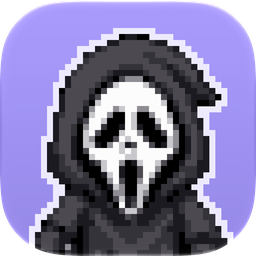
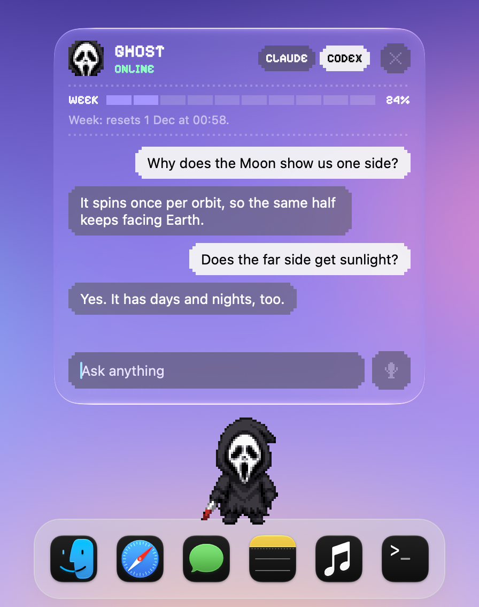
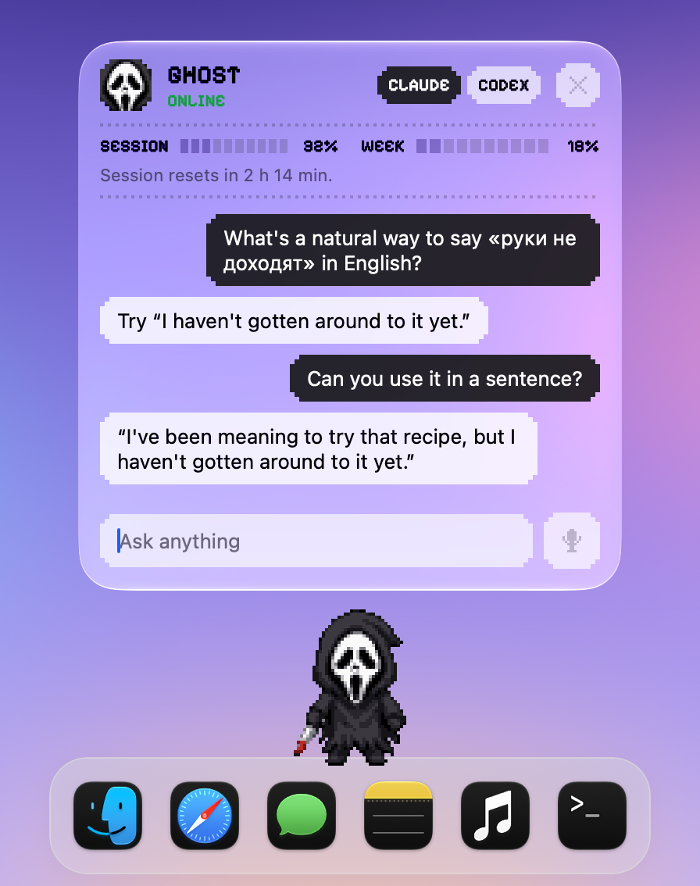
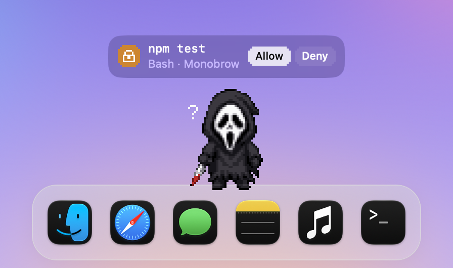
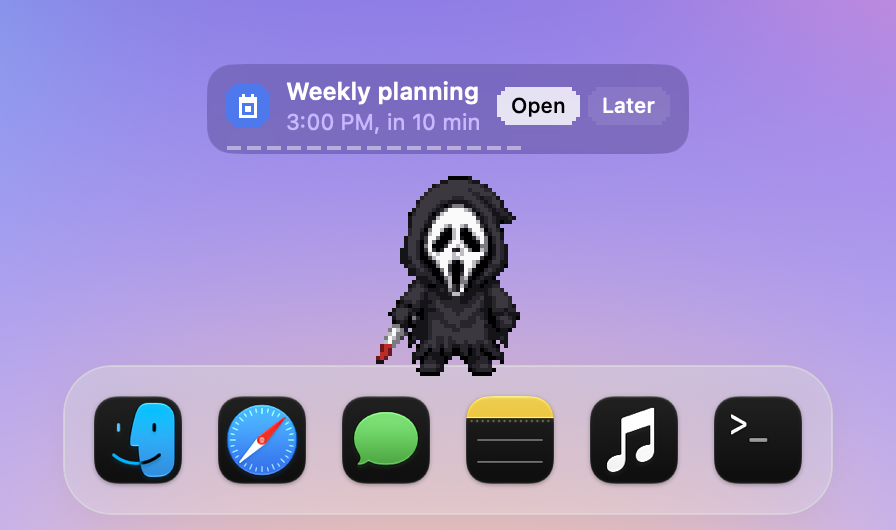
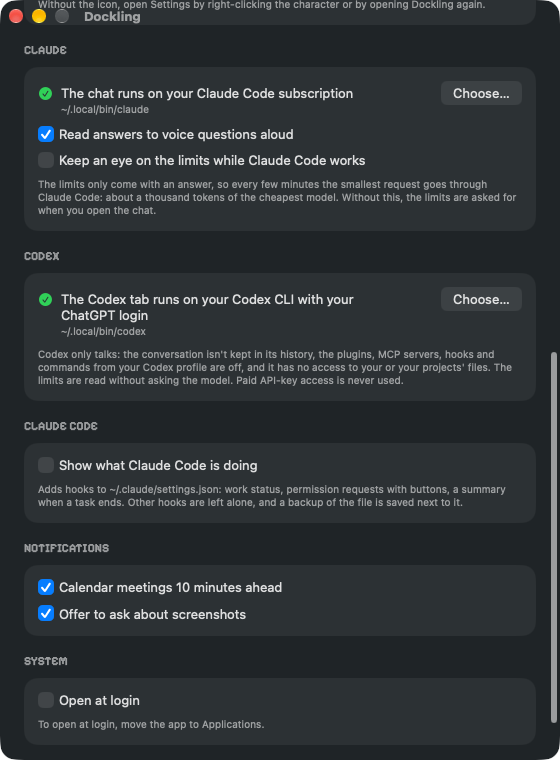

<p align="center">
  
</p>

<h1 align="center">Dockling</h1>

<p align="center">
  A pixel pet for the Mac Dock. Chat with Claude or Codex and see your plan limits.
</p>

<p align="center">
  <a href="https://github.com/rbnmssno/Dockling/releases/latest"></a>
  
  <a href="https://github.com/rbnmssno/Dockling/actions/workflows/build.yml"></a>
  <a href="LICENSE"></a>
</p>

<p align="center">
  <a href="https://github.com/rbnmssno/Dockling/releases/latest/download/Dockling.dmg"><b>Download Dockling.dmg</b></a>
  &nbsp;·&nbsp;
  <a href="#по-русски">Русская версия</a>
</p>

## New in 1.4

Click the pet and choose **Claude** (⌘1) or **Codex** (⌘2). Each tab keeps its own conversation, draft and attachment. Switch while an answer is coming in and you can come back to it when it's ready. Dockling remembers which tab you used last.

The selected tab shows how much of your plan you've used. Codex reads this from the account you signed into with ChatGPT, so you can see the percentages and the next reset before sending a message. If your plan reports just a weekly limit, you see one bar. A card names the provider when usage reaches 85% or 98%.

| Codex in dark mode | Claude in light mode |
|---|---|
|  |  |

<p align="center">
  
</p>

While Claude Code works, the pet sits down at a laptop. It brings you permission requests with Allow and Deny buttons and tells you when a task finishes. When the pet stands or sleeps, it uses about 20 MB of memory and 0% CPU.

| Claude Code asks for permission | A meeting in ten minutes |
|---|---|
|  |  |

## Download

[Dockling.dmg](https://github.com/rbnmssno/Dockling/releases/latest/download/Dockling.dmg) for macOS 14 or later on Apple silicon. The glass looks its best on macOS 26.

The first launch needs to be allowed by hand once:

1. Open the disk image and drag Dockling to Applications.
2. Open Dockling. macOS refuses to run it; click Done.
3. Go to System Settings → Privacy & Security, scroll down and click Open Anyway next to the Dockling message.

Instead of steps 2 and 3 you can clear the quarantine flag in Terminal:

```
xattr -dr com.apple.quarantine /Applications/Dockling.app
```

Set up the assistant you want to use. For **Codex**, sign into the Codex CLI with ChatGPT. For **Claude**, sign into Claude Code. Dockling finds the installed tools automatically. You can also choose their paths in Settings. [Codex CLI](https://developers.openai.com/codex/cli/) · [Claude Code](https://code.claude.com)

## What it does

- Walks along the Dock on its own and stops when the cursor is on it. You can pick it up and drop it.
- Falls asleep after five minutes without mouse or keyboard input and wakes up when you're back. Waves when the Mac starts or wakes.
- Lives where the Dock is. When the Dock moves to another display it dives after it. While a video, game or app is in full screen, it stays with the desktop: a swipe to the video carries it away, the swipe back brings it in. Reminders and meetings that came up meanwhile show when it is back.
- Ask by voice, drop a screenshot or use the macOS Services menu. Dockling sends the question to the selected tab.
- Each provider has its own usage warnings. An optional setting also checks Claude limits while Claude Code works with the chat closed.
- Drop a file or some text on it, or take a screenshot, and ask about it.
- Hold ⌥ or the microphone button to ask by voice; the answer is read out.
- "Remind me in 20 minutes to call Alex" in the chat sets a reminder. Reminders survive a restart.
- Meetings from the Calendar app, Google accounts included: a card ten minutes before.
- Claude Code: a working animation, permission requests with Allow and Deny, a one-line summary when a task ends, and a number over its head when several sessions run.
- Reacts to the charger, low battery and music in Spotify or Apple Music.
- Two Services items for selected text in any app: Ask the Ghost, and Translate with the Ghost.
- Light, dark or automatic theme, and glass from solid to fully clear.
- English or Russian, following the system language.

<p align="center">
  
</p>

## How it works

The Claude tab runs one `claude -p` process per conversation, with JSON going in and out as a stream and every tool turned off, so the pet can only talk. It runs on your own Claude Code login. `ANTHROPIC_API_KEY` is removed from its environment so it can't switch to API billing by accident. Both tabs receive the current time with each message. If calendar reminders are on and you grant calendar access, they also receive today's meeting times and titles.

Claude Code reports the plan's limits only together with an answer, and keeps no live copy of them an app could read (its own cache in `~/.claude.json` can be hours behind). So when the chat opens, one smallest request goes through the same Claude Code: the cheapest model, a one-word answer, no tools, about a thousand tokens. The process is ended as soon as the limits have arrived, about a second later. With "Keep an eye on the limits while Claude Code works" on in Settings, the same request goes out shortly after each thing Claude Code does and every ten minutes during a task, never more often than once in four minutes; it is off by default.

The Codex tab uses the local `codex app-server` and your ChatGPT login. Dockling reads the usage windows with `account/rateLimits/read`. The conversation stays out of Codex's saved history. You can interrupt a reply with Stop and continue the same conversation.

Dockling disables the shell, web search, hooks, plugins and external MCP servers for the chat. Its permission profile blocks file writes and access to project folders. The remaining built-in tools can read the system paths required by macOS (including `/tmp`), an empty chat folder and the Codex executable. Dockling checks the effective settings and the login before sending a message. It blocks sending if the service reports that ordinary usage is unavailable.

Claude Code's state comes from hooks. The switch in Settings adds them to `~/.claude/settings.json`, keeps everyone else's hooks and saves a backup of the file first. The hook script hands each event to the app over a local socket. When Dockling isn't running, or the pet is out of sight, Claude Code asks for permissions in its own dialog as usual.

Every animation is a row of the sprite sheet played by Core Animation. The window server draws the frames, so the app does no work while he walks or sleeps.

macOS doesn't tell apps where the Dock is, so its width is worked out from the Dock's own settings: icon size, pinned apps and the apps that are running.

Nor does macOS say when the Dock goes to another display. That happens in one way only, when the cursor is pushed against the bottom edge of a display the Dock isn't on, so a transparent strip a few points high lies along that edge. The cursor reaching it starts a two-second run of looks at where the Dock's own window is; when it has moved, he dives below the edge and comes up on the Dock there. Nothing runs while the cursor is elsewhere.

He belongs to a desktop the way a window does, so macOS itself carries him off the screen with the desktop when you swipe to a full-screen app, and brings him back with it; nothing is hidden or shown by a timer. Whether a display is showing a desktop or a full-screen Space is asked from the window server (`CGSCopyManagedDisplaySpaces`, the call window managers use, as there is no public one). If a future macOS drops it, a window that covers the whole screen counts as full screen instead.

## Building

You need Xcode 26 (it compiles the icon) or the Command Line Tools with Swift 5.9 or later.

```
scripts/build.sh
```

This makes `dist/Dockling.app` and `dist/Dockling.dmg`. `swift test` runs the checks of the limits, the Codex safeguards and the conversation logic. A copy you build yourself opens without the Gatekeeper step. Release disk images are built by GitHub Actions from the tagged source.

Each build is signed ad hoc, which makes macOS ask for the calendar and microphone again after every rebuild. Run `scripts/make-signing-identity.sh` once to avoid that: it creates a self-signed certificate in a keychain of its own inside the project (`signing/`, ignored by git), and the build uses it from then on.

Development switches:

```
Dockling --log                       # print what happens
Dockling --isolated                  # a test copy beside your own Dockling, with its own settings and data
Dockling --demo walk                 # also: chat, cards, sleep, work, settings, codex-limits, codex, tabs
Dockling --provider codex            # open the chat on the Codex tab
Dockling --isolated --showcase DIR   # the pictures and the animation above, on a stage of its own
Dockling --dock-display external     # his Dock on that display (or main), whatever the real Dock does
```

Add `-AppleLanguages '(en)'` or `'(ru)'` to run in one language. The binary is `dist/Dockling.app/Contents/MacOS/Dockling`.

## Uninstalling

If you turned on the Claude Code hooks, turn them off in Settings first; that removes them from `~/.claude/settings.json`. Then quit Dockling, delete the app and `~/Library/Application Support/Dockling`.

## Credits

The character is fan art of Ghostface from *Scream*, based on a sprite sheet published on [codex-pet.com](https://www.codex-pet.com/pets/ghostface), cleaned up and extended with more animations. It isn't covered by the MIT license; the rights belong to their owners.

The pixel font, Ghost Pixel, is [Pixelify Sans](https://github.com/eifetx/Pixelify-Sans) with a few letters redrawn, under the SIL Open Font License 1.1.

## По-русски

Dockling — пиксельный питомец для Dock на Mac. По клику он открывает чат с Claude или Codex. Пока Claude Code работает, питомец садится за ноутбук, приносит запросы на разрешения и сообщает о завершении задачи. Интерфейс следует языку системы и поддерживает русский и английский.

### Что нового в 1.4

Выбирай **Claude** (⌘1) или **Codex** (⌘2) прямо в шапке чата. У каждого своя переписка, черновик и вложение. Можно задать вопрос Codex, перейти к Claude и потом вернуться за ответом. При следующем открытии питомец покажет последнюю выбранную вкладку.

Лимиты Codex видны до первого сообщения. Питомец запрашивает у аккаунта ChatGPT процент расхода и время ближайшего сброса. Если аккаунт вернул только недельный лимит, появится одна шкала. Когда расход достигает 85% или 98%, в карточке предупреждения видно, у какого помощника заканчивается лимит.

Ресурсов почти не тратит: 0% процессора, пока стоит или спит, и около 20 МБ памяти.

### Установка

[Скачать Dockling.dmg](https://github.com/rbnmssno/Dockling/releases/latest/download/Dockling.dmg). Нужна macOS 14 или новее на Apple silicon. Стекло лучше всего выглядит на macOS 26.

Первый запуск нужно один раз разрешить вручную:

1. Открой образ и перетащи Dockling в «Программы».
2. Запусти Dockling. macOS откажется его открывать, нажми «Готово».
3. Открой «Системные настройки» → «Конфиденциальность и безопасность», прокрути вниз и нажми «Всё равно открыть» рядом с сообщением о Dockling.

Вместо шагов 2 и 3 можно снять карантин в Терминале:

```
xattr -dr com.apple.quarantine /Applications/Dockling.app
```

Для **Codex** войди в Codex CLI через ChatGPT. Для **Claude** войди в Claude Code. Достаточно настроить того помощника, которым хочешь пользоваться. Dockling находит программы сам. При необходимости путь можно выбрать в настройках.

### Что умеет

- Сам гуляет по Dock, останавливается под курсором. Его можно взять мышкой и уронить.
- Засыпает, если пять минут не трогать мышь и клавиатуру, и просыпается, когда ты вернулся. Машет, когда Mac включается или просыпается.
- Живёт там, где Dock. Dock переехал на другой монитор — ныряет за ним. Пока открыто видео, игра или приложение во весь экран, держится рабочего стола: смахнул на видео — уехал вместе со столом, смахнул обратно — уже на месте. Напоминания и встречи, которые пришлись на это время, покажет, когда вернётся.
- Отправляет голосовые вопросы, скриншоты и выделенный текст из меню «Службы» в выбранный чат.
- Показывает лимиты каждого помощника. В настройках можно также включить предупреждения о лимитах Claude, пока Claude Code работает с закрытым чатом.
- Можно бросить на него файл или текст, сделать скриншот и спросить про них.
- Если зажать ⌥ или кнопку микрофона, можно спросить голосом, ответ он прочитает вслух.
- «Напомни через 20 минут позвонить» в чате ставит напоминание. Оно сохранится, даже если перезапустить Mac.
- Встречи из «Календаря» (Google тоже, если аккаунт добавлен в macOS): карточка за 10 минут.
- Claude Code: анимация работы, запросы на разрешения с кнопками, короткий итог по готовой задаче и цифра над головой, если сессий несколько.
- Реагирует на зарядку, низкий заряд и музыку в Spotify или Apple Music.
- В меню «Службы» для выделенного текста: «Спросить призрака» и «Перевести с призраком».

Codex во вкладке только разговаривает: разговор не сохраняется в его истории, плагины, MCP, хуки, команды и поиск из профиля Codex выключены, нет доступа к файлам пользователя и проектов, лимиты читаются без запроса к модели. Если защиту включить не удалось или Codex вошёл по API-ключу, чат не запускается и объясняет почему. Когда сервис сообщает, что обычные запросы недоступны, Dockling блокирует отправку.

Хуки Claude Code включаются в настройках. Они дописываются в `~/.claude/settings.json`, чужие хуки остаются, копия файла сохраняется рядом.

Сборка из исходников, режимы для разработки и удаление описаны выше в английской части.

---

Dockling is an independent project. [MIT license](LICENSE).
