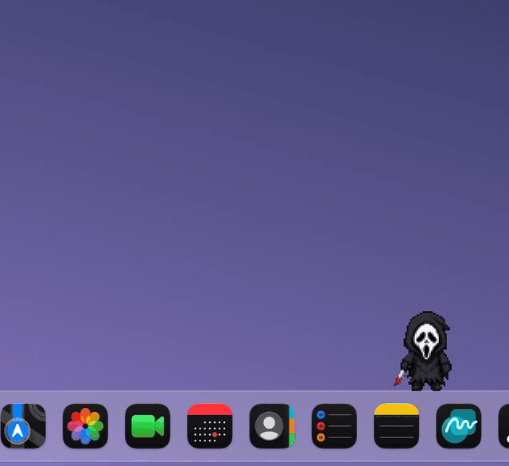

# Dockling

A pixel pet that lives on the Mac's Dock. Click it and a small chat with Claude opens. It also keeps an eye on Claude Code: it sits down at a laptop while Claude works, brings you permission requests and tells you when a task is done.

[](https://github.com/rbnmssno/Dockling/actions/workflows/build.yml) · [Русская версия](#по-русски)



It costs next to nothing to keep around: 0% CPU while it stands or sleeps, and about 15 MB of memory.

| Chat, dark theme | Chat, light theme |
|---|---|
|  |  |

| Claude Code asks for permission | A meeting in ten minutes |
|---|---|
|  |  |

## Download

[Dockling.dmg](https://github.com/rbnmssno/Dockling/releases/latest/download/Dockling.dmg) for macOS 14 or later on Apple silicon. The glass looks its best on macOS 26. The interface is in Russian.

The first launch needs to be allowed by hand once:

1. Open the disk image and drag Dockling to Applications.
2. Open Dockling. macOS refuses to run it; click Done.
3. Go to System Settings → Privacy & Security, scroll down and click Open Anyway next to the Dockling message.

Instead of steps 2 and 3 you can clear the quarantine flag in Terminal:

```
xattr -dr com.apple.quarantine /Applications/Dockling.app
```

The chat needs [Claude Code](https://code.claude.com) installed and signed in. The command-line version and the copy inside the VS Code extension both work; Dockling finds either one, and Settings has a field for anything unusual.

## What it does

- Walks along the Dock on its own and stops when the cursor is on it. You can pick it up and drop it.
- Falls asleep after five minutes without mouse or keyboard input and wakes up when you're back. Waves when the Mac starts or wakes.
- Click it to chat. Your plan's session and weekly limits are at the top of the chat, and a card warns you at 85% and 98%.
- Drop a file or some text on it, or take a screenshot, and ask about it.
- Hold ⌥ or the microphone button to ask by voice; the answer is read out.
- "Напомни через 20 минут позвонить" in the chat sets a reminder. Reminders survive a restart.
- Meetings from the Calendar app, Google accounts included: a card ten minutes before.
- Claude Code: a working animation, permission requests with Allow and Deny, a one-line summary when a task ends, and a number over its head when several sessions run.
- Reacts to the charger, low battery and music in Spotify or Apple Music.
- Two Services items for selected text in any app: ask it, or translate.
- Light, dark or automatic theme, and glass from solid to fully clear.


## How it works

The chat is one `claude -p` process per conversation, with JSON going in and out as a stream and every tool turned off, so the pet can only talk. It runs on your own Claude Code login. `ANTHROPIC_API_KEY` is removed from its environment so it can't switch to API billing by accident. Each message starts with the current time and today's calendar events, so it can answer questions about your day.

Claude Code's state comes from hooks. The switch in Settings adds them to `~/.claude/settings.json`, keeps everyone else's hooks and saves a backup of the file first. The hook script hands each event to the app over a local socket. When Dockling isn't running the script exits quietly, and Claude Code asks for permissions in its own dialog as usual.

Every animation is a row of the sprite sheet played by Core Animation. The window server draws the frames, so the app does no work while he walks or sleeps.

macOS doesn't tell apps where the Dock is, so its width is worked out from the Dock's own settings: icon size, pinned apps and the apps that are running.

## Building

You need Xcode 26 (it compiles the icon) or the Command Line Tools with Swift 5.9 or later.

```
scripts/build.sh
```

This makes `dist/Dockling.app` and `dist/Dockling.dmg`. A copy you build yourself opens without the Gatekeeper step.

Each build is signed ad hoc, which makes macOS ask for the calendar and microphone again after every rebuild. Run `scripts/make-signing-identity.sh` once to avoid that: it creates a self-signed certificate in a keychain of its own inside the project (`signing/`, ignored by git), and the build uses it from then on.

Development switches:

```
Dockling --log                 # print what happens
Dockling --demo walk           # also: chat, cards, sleep, work, settings
Dockling --showcase DIR        # the pictures and the GIF above, recorded over a backdrop of its own
```

The binary is `dist/Dockling.app/Contents/MacOS/Dockling`.

## Uninstalling

If you turned on the Claude Code hooks, turn them off in Settings first; that removes them from `~/.claude/settings.json`. Then quit Dockling, delete the app and `~/Library/Application Support/Dockling`.

## Credits

The character is fan art of Ghostface from *Scream*, based on a sprite sheet published on [codex-pet.com](https://www.codex-pet.com/pets/ghostface), cleaned up and extended with more animations. It isn't covered by the MIT license; the rights belong to their owners.

The pixel font, Ghost Pixel, is [Pixelify Sans](https://github.com/eifetx/Pixelify-Sans) with a few letters redrawn, under the SIL Open Font License 1.1.

## По-русски

Dockling — пиксельный питомец, который живёт на Dock. Кликни по нему, и откроется маленький чат с Claude. Ещё он следит за Claude Code: садится за ноутбук, пока Claude работает, приносит запросы на разрешения и говорит, когда задача готова. Интерфейс на русском.

Ресурсов почти не тратит: 0% процессора, пока стоит или спит, и около 15 МБ памяти.

### Установка

[Скачать Dockling.dmg](https://github.com/rbnmssno/Dockling/releases/latest/download/Dockling.dmg). Нужна macOS 14 или новее на Apple silicon. Стекло лучше всего выглядит на macOS 26.

Первый запуск нужно один раз разрешить вручную:

1. Открой образ и перетащи Dockling в «Программы».
2. Запусти Dockling. macOS откажется его открывать, нажми «Готово».
3. Открой «Системные настройки» → «Конфиденциальность и безопасность», прокрути вниз и нажми «Всё равно открыть» рядом с сообщением о Dockling.

Вместо шагов 2 и 3 можно снять карантин в Терминале:

```
xattr -dr com.apple.quarantine /Applications/Dockling.app
```

Для чата нужен установленный Claude Code, в который ты вошёл. Подходит и консольная версия, и та, что внутри расширения для VS Code: Dockling найдёт любую сам.

### Что умеет

- Сам гуляет по Dock, останавливается под курсором. Его можно взять мышкой и уронить.
- Засыпает, если пять минут не трогать мышь и клавиатуру, и просыпается, когда ты вернулся. Машет, когда Mac включается или просыпается.
- По клику открывает чат. Сверху видны лимиты подписки за сессию и за неделю, на 85% и 98% придёт карточка.
- Можно бросить на него файл или текст, сделать скриншот и спросить про них.
- Если зажать ⌥ или кнопку микрофона, можно спросить голосом, ответ он прочитает вслух.
- «Напомни через 20 минут позвонить» в чате ставит напоминание. Оно сохранится, даже если перезапустить Mac.
- Встречи из «Календаря» (Google тоже, если аккаунт добавлен в macOS): карточка за 10 минут.
- Claude Code: анимация работы, запросы на разрешения с кнопками, короткий итог по готовой задаче и цифра над головой, если сессий несколько.
- Реагирует на зарядку, низкий заряд и музыку в Spotify или Apple Music.
- В меню «Службы» для выделенного текста: «Спросить призрака» и «Перевести с призраком».

Хуки Claude Code включаются в настройках. Они дописываются в `~/.claude/settings.json`, чужие хуки остаются, копия файла сохраняется рядом.

Сборка из исходников, режимы для разработки и удаление описаны выше в английской части.

---

Dockling is a personal project, not affiliated with Anthropic. [MIT license](LICENSE).
